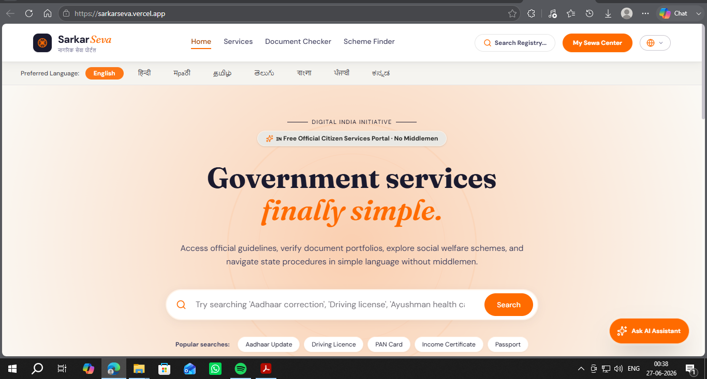
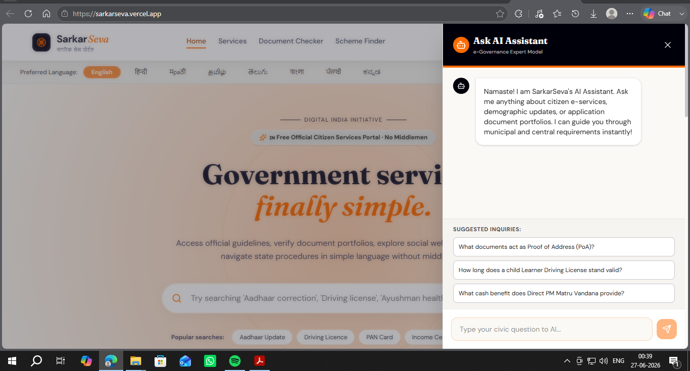

<div align="center">

# 🏛️ SarkarSeva

### AI-powered, multilingual civic services portal for everyday citizens of India

[](https://github.com/satvikpandurangi/sarkarseva)
[](https://sarkarseva.vercel.app)
[](https://github.com/satvikpandurangi/sarkarseva)

[**Live Demo**](https://sarkarseva.vercel.app) · [**Report an Issue**](https://github.com/satvikpandurangi/sarkarseva/issues)

</div>

---

## 📖 Overview

**SarkarSeva** is an AI-powered, multilingual civic services portal designed to simplify government procedures, document checklists, and schemes for everyday citizens of India. It uses Google's Gemini API to help users navigate bureaucratic processes more easily, presenting information in a clean, conversational interface built with React and Tailwind CSS.

## ✨ Features

- 🤖 **AI-Powered Assistance** — Powered by Google's Gemini API (`@google/genai`) to answer civic and government-procedure queries
- 🌐 **Multilingual Support** — Designed to serve citizens across different languages
- 📋 **Document & Scheme Guidance** — Simplifies document checklists and government schemes
- 💬 **Conversational Markdown Rendering** — Responses rendered with `react-markdown` and GFM support for clear, structured answers
- 🎨 **Modern, Animated UI** — Smooth interactions powered by `motion` (Framer Motion) and `lucide-react` icons
- ⚡ **Fast, Server-Rendered Experience** — Built on Vite with an Express/TypeScript backend server
- 🎯 **Explainable Scheme Matching** — Deterministic profile-based ranking with pass/fail reasons, confidence, and hard-fail protection
- 🧭 **Application Guidance** — Scheme-specific preparation documents, numbered steps, and direct official-portal links

## 🏆 Jury & Technical Documentation

The complete [technical report](docs/TECHNICAL_REPORT.md) maps the product to the expected outcomes and includes Mermaid diagrams for the application flow, system architecture, matching engine, AI sequence, and deployment flow. It also contains a three-minute demonstration script and matching-analysis methodology.

Run the repeatable matcher benchmark with:

```bash
npm run test:matcher
```

## 🛠️ Tech Stack

| Layer | Technology |
|-------|------------|
| Frontend | React 19, TypeScript, Vite 6 |
| Styling | Tailwind CSS 4 (`@tailwindcss/vite`) |
| AI | Google Gemini API (`@google/genai`) |
| Backend | Express, Node.js, `tsx` |
| UI/UX | Framer Motion (`motion`), `lucide-react`, `clsx`, `tailwind-merge` |
| Content Rendering | `react-markdown`, `remark-gfm` |
| Deployment | Vercel |

## 📂 Project Structure

```
sarkarseva/
├── api/              # API route handlers
├── public/           # Static assets
├── src/              # React application source
├── server.ts         # Express server entry point
├── vite.config.ts    # Vite configuration
├── vercel.json       # Vercel deployment configuration
├── tsconfig.json     # TypeScript configuration
├── .env.example       # Environment variable reference
└── package.json
```

## 📸 Screenshots

<div align="center">

### Home Page


### AI Assistant View


</div>

## 🚀 Installation

**Prerequisites:** Node.js

```bash
# Clone the repository
git clone https://github.com/satvikpandurangi/sarkarseva.git
cd sarkarseva

# Install dependencies
npm install
```

Set your Gemini API key in `.env.local` (use `.env.example` as a reference):

```
GEMINI_API_KEY=your_gemini_api_key_here
```

<details>
<summary>📦 Dependency Notes</summary>

Core dependencies include `@google/genai`, `react`, `react-dom`, `express`, `vite`, and `tailwindcss`. See [`package.json`](https://github.com/satvikpandurangi/sarkarseva/blob/main/package.json) for the full list.

</details>

## 💻 Local Development

```bash
npm run dev
```

This starts the app locally via `tsx server.ts`. Open the printed local URL in your browser to use the app.

<details>
<summary>🔧 Other available scripts</summary>

```bash
npm run build   # Builds the client (Vite) and bundles the server with esbuild
npm run start   # Runs the production server from dist/server.cjs
npm run lint    # Type-checks the project with tsc --noEmit
npm run clean   # Removes build output
```

</details>

## ☁️ Deployment

SarkarSeva is deployed on **Vercel** and is live at **[sarkarseva.vercel.app](https://sarkarseva.vercel.app)**. The repository includes a `vercel.json` configuration for deployment. To deploy your own instance:

1. Fork or clone this repository.
2. Import the project into [Vercel](https://vercel.com).
3. Add the `GEMINI_API_KEY` environment variable in your Vercel project settings.
4. Deploy.

## 🔮 Future Improvements

- Expand language coverage for broader accessibility
- Add more government schemes and document checklists
- Improve mobile responsiveness and offline support

## 🤝 Contributing

Contributions are welcome! To contribute:

1. Fork the repository
2. Create a feature branch (`git checkout -b feature/your-feature`)
3. Commit your changes
4. Open a pull request

Please open an issue first for major changes to discuss what you'd like to change.
