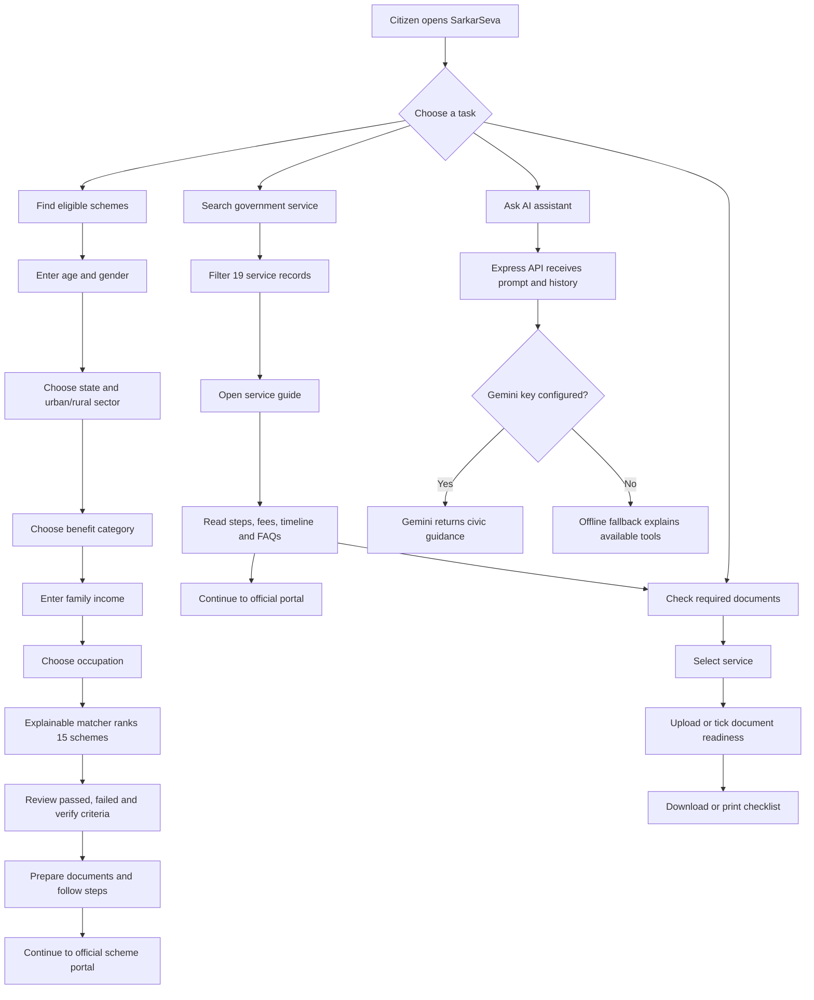
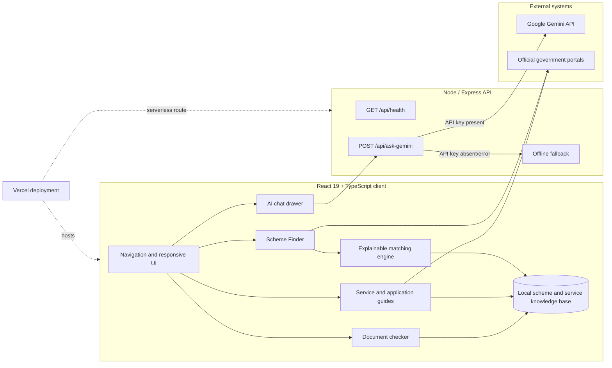
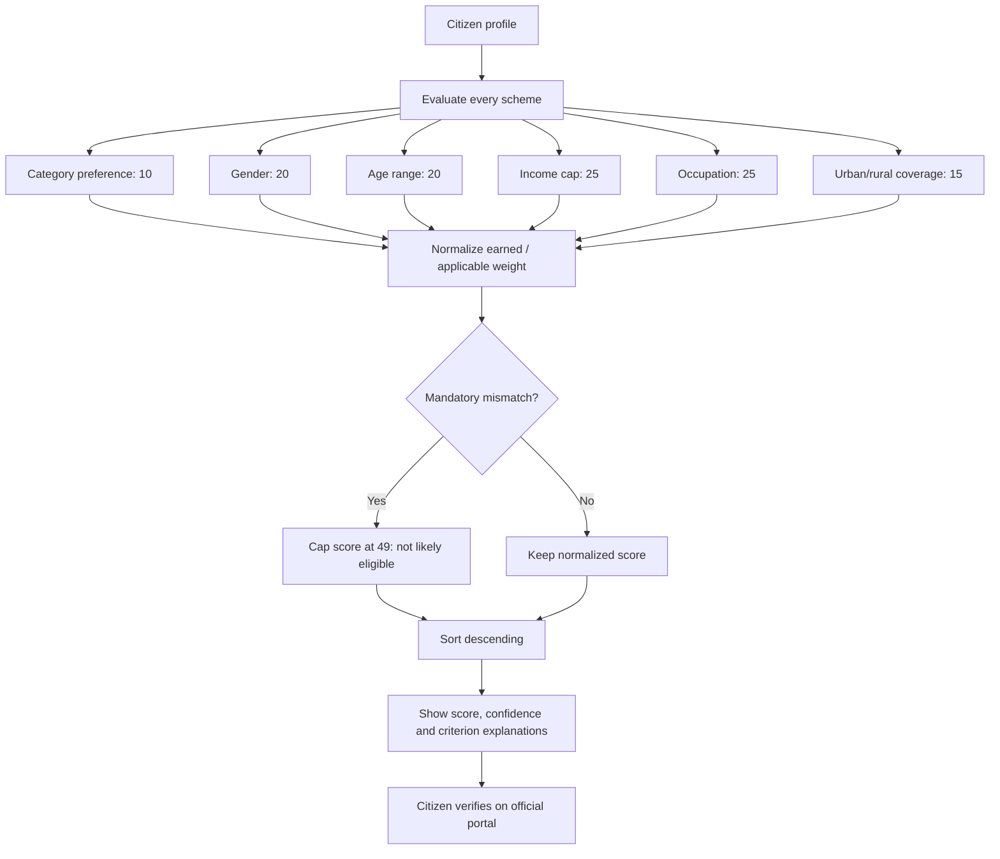
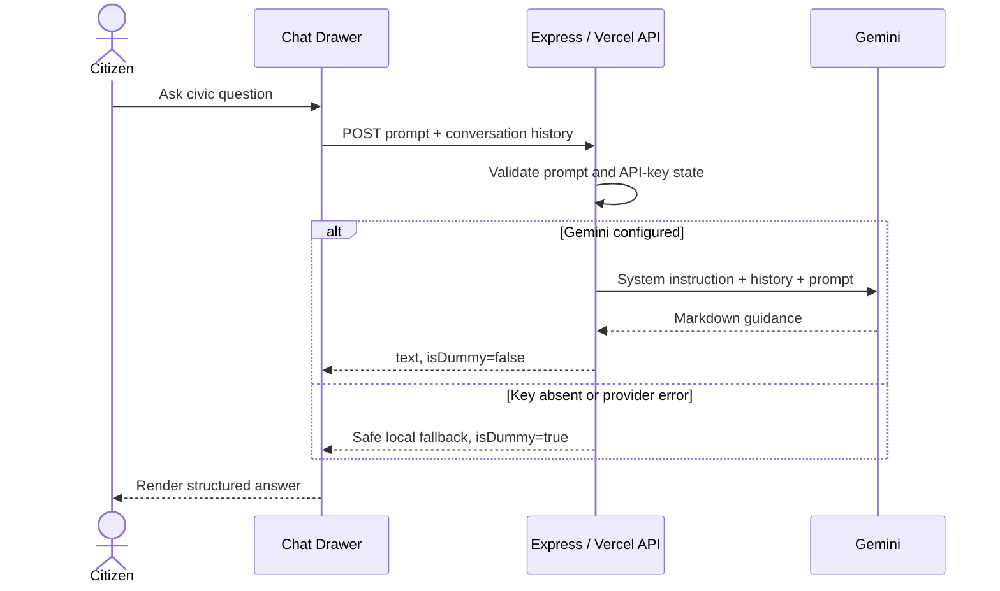
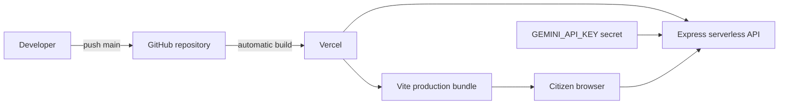

# SarkarSeva — Technical Report and Jury Guide

## 1. Executive summary

SarkarSeva is a working multilingual civic-assistance platform that helps an Indian citizen discover government services, pre-screen welfare-scheme eligibility, prepare documents, follow application steps, and ask an AI assistant for plain-language guidance. The product combines a curated local knowledge base with an explainable rule engine; Gemini is used for conversational guidance, not for deciding eligibility.

> Important: match scores are pre-screening guidance. The relevant government authority makes the final eligibility decision.

## 2. Expected-outcome coverage

| Expected outcome | Implementation | Jury evidence |
|---|---|---|
| Working AI government-scheme matching platform | Five-step citizen profile, live ranking, details modal, Gemini assistant | Open **Scheme Finder**, change income/occupation, then open **Quick Check** |
| Scheme and eligibility knowledge base | 15 central-scheme records plus 19 service guides, eligibility rules, benefits, documents, official links | `src/data.ts`, `src/services_data.ts`, `src/scheme_guidance.ts` |
| Personalized scheme matching module | Deterministic weighted rules for age, gender, income, occupation, sector and category | `src/lib/schemeMatcher.ts` |
| Application guidance interface | Per-scheme documents, numbered application steps and official-portal redirects; service guides and document checker | Scheme **Quick Check** and any **Service Guide** |
| Matching accuracy and user-guidance analysis | Explainable pass/fail criteria, evidence confidence, mandatory-rule hard-fail cap, repeatable five-persona benchmark | `npm run test:matcher` and the analysis below |
| Final technical report and demonstration | This report, architecture diagrams and a timed demo script | `docs/TECHNICAL_REPORT.md` |

## 3. Application flow



## 4. System architecture



## 5. Matching-engine flow



### Why this is explainable

- Only rules applicable to a scheme enter its denominator.
- Category is treated as a preference; age, gender, income, occupation and sector are eligibility evidence.
- Any failed mandatory criterion caps the result below the 75% “High Match” threshold.
- The UI shows exactly which rules passed, failed, or still require official verification.
- Location is marked **verify** because central schemes can have state-specific implementation details.

## 6. AI request sequence



## 7. Matching analysis and validation

The included benchmark uses five representative personas: a low-income student, rural farmer, urban street vendor, low-income senior citizen, and woman seeking LPG support. Each scenario declares an expected scheme that must appear in the top three.

Run:

```bash
npm run test:matcher
```

This is a deterministic regression benchmark, not a claim of real-world approval accuracy. A production evaluation should add anonymised labelled cases reviewed by domain experts and report precision@k, recall@k, false-positive rate and subgroup performance.

## 8. Data and privacy design

- Profile answers remain in React state; this version does not persist or transmit them.
- Uploaded documents are validated in-browser and represented only by file metadata; files are not sent to a server.
- Gemini receives only the user’s chat prompt and chat history.
- The Gemini API key remains server-side.
- Official applications occur on government portals, not inside SarkarSeva.

## 9. Deployment flow



## 10. Three-minute jury demonstration

1. **0:00–0:25 — Problem and promise:** “Government information is fragmented and difficult to interpret. SarkarSeva turns discovery, eligibility pre-screening and application preparation into one guided journey.”
2. **0:25–1:20 — Personalized matching:** Open **Scheme Finder**. Use a 35-year-old rural farmer profile with Agriculture selected. Show how results update, open PM-KISAN **Quick Check**, and point to rule explanations and confidence.
3. **1:20–1:55 — Application guidance:** In the same modal, show benefits, required documents, numbered steps and the official portal redirect.
4. **1:55–2:25 — Service workflow:** Search for Passport, open the guide, then the Document Checker. Tick/upload an item and download the readiness checklist.
5. **2:25–2:45 — AI:** Ask, “What documents do I need before a fresh passport application?” Show structured markdown guidance and explain the offline fallback.
6. **2:45–3:00 — Technical proof:** Show the architecture diagram and run `npm run test:matcher`; close with the privacy boundary and official-verification disclaimer.

## 11. Known limitations and next steps

- Scheme rules and deadlines change; introduce scheduled content review with source timestamps.
- Add state-specific schemes and jurisdiction rules.
- Validate the matcher against a larger expert-labelled dataset before claiming measured field accuracy.
- Add authentication and encrypted persistence only when application tracking becomes real rather than demonstrative.
- Add accessibility and multilingual content QA with native speakers.
